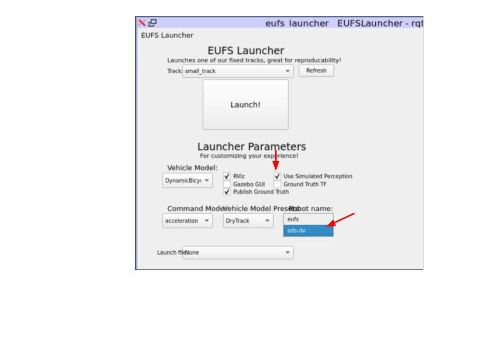
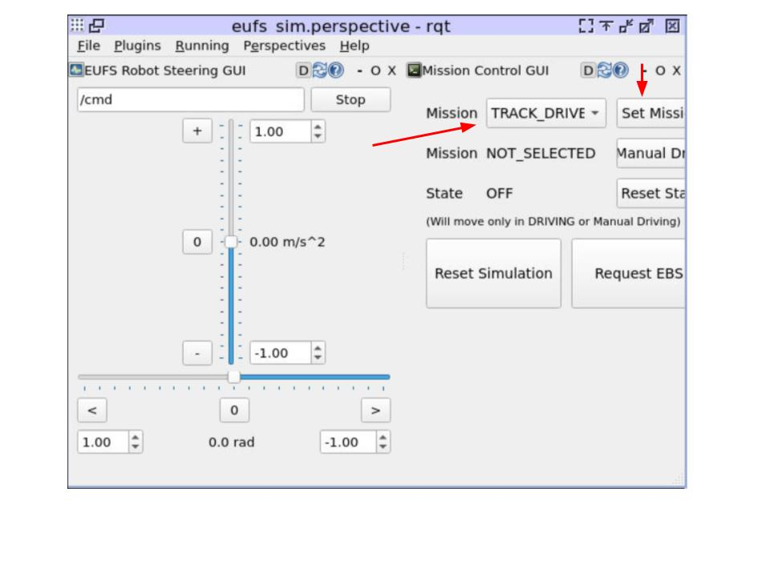

# Development Guide


:::info Windows users
Run every command on this page inside WSL, not PowerShell or CMD. If you haven't set it up yet, follow [Installing WSL](/docs/tutorial-getting-started/windows-startup/installing-wsl.md) first.
:::

## IDE

We recommend [Emacs](https://www.gnu.org/software/emacs/) if you're a GOAT with a **lot** of time to waste. Otherwise, [VS Code](https://code.visualstudio.com/) works well.

## Launching and building the stack

Everything runs from the root of `wuair_v2`. You can use our scripts or plain `docker compose`; both do the same thing.

**With the scripts:**

```bash
./scripts/build.sh          # build every image
./scripts/launch_sim.sh     # dev_gui: EUFS sim + RViz in your browser
./scripts/real_launch.sh    # the autonomy stack (sensors, perception, state_est, controls)
./scripts/down.sh           # stop everything
```

**With `docker compose`:**

```bash
docker compose --profile full --profile dev_gui build     # build every image
docker compose --profile full --profile dev_gui up -d     # start the stack + sim
docker compose --profile full --profile dev_gui down      # stop everything
```

The `full` profile is the four autonomy modules and `dev_gui` is the sim. To work on one module at a time, swap in its own profile (`sensors`, `perception`, `state_est`, `controls`, `dev_gui`):

```bash
docker compose --profile state_est build
docker compose --profile state_est up -d
```

:::warning
`./scripts/build.sh` does two things `docker compose build` doesn't: it updates the git submodules and copies `shared/wuair_msgs/` into every module. If you pulled new submodules or changed a shared message, build with the script.
:::

:::tip Only run what you need
In the sim, only run the nodes you're actually testing. If you're working on state estimation, don't run our perception at all and let the sim give you ground truth cones instead. That way perception errors can't leak into your results, and you're only testing your own code.

Leave out the perception container:

```bash
./scripts/real_launch.sh --no-perception
```

or

```bash
docker compose --profile sensors --profile state_est --profile controls --profile dev_gui up -d
```

Then tick **Use Simulated Perception** in the EUFS launcher (see [Running on the simulator](#running-on-the-simulator)) so the sim publishes the cones.
:::

## Interfacing with the containers

Every module runs in its own container, and each module's `src/` folder is live-mounted into it:

```text
wuair_v2/<module>/src   (host)   ->   /ros_ws/src   (container)
```

So the workflow is: open the module's source in your IDE (VS Code, etc.) on your host and edit it there. Anything you save shows up in the container immediately; there's no copying files around. Config is mounted the same way, read-only, at `/ros_ws/config` (`wuair_v2/<module>/config` on the host).

:::warning
Edit code on your host, not inside the container. Shared messages are the one exception to "edit in your module": change them in `shared/wuair_msgs/` only. The copies in `<module>/src/wuair_msgs/` get overwritten by `./scripts/build.sh`.
:::

### Running nodes in the existing tmux session

When a container starts, it launches all of its nodes in a tmux session, one window per node. This is where you'll do most of your work. Use the node's own window to stop it, rebuild it and start it again, so you never end up with two copies of the same node fighting over the same topics.

Attach to the container's tmux session (the session is named after the module):

```bash
docker exec -it wuair_sensors tmux attach -t sensors
docker exec -it wuair_perception tmux attach -t perception
docker exec -it wuair_state_est tmux attach -t state_est
docker exec -it wuair_controls tmux attach -t controls
docker exec -it wuair_dev_gui tmux attach -t dev_gui
```

Each window is named after its node:

| Session      | Windows                                                                                   |
|--------------|-------------------------------------------------------------------------------------------|
| `sensors`    | `oak_tf`, `lidar_relay`, `lidar_tf`, `shell` (plus `oak_camera`, `oak_imu_tf` on the car) |
| `perception` | `perception_cones` (just `idle` when ground truth cones are on in `.env`)                 |
| `state_est`  | `slam_node`, `lap_counter`, `state_machine`                                               |
| `controls`   | `controller`, `path_planner`, `autotune` (plus `ros_can` on the car)                      |
| `dev_gui`    | `imu_relay`, `gps_relay`, `eufs_launcher`, `rqt`, `shell`                                  |

To restart a node with your changes:

1. Press `Ctrl+b` then `w` to open the window picker and pick the node's window. Mouse mode is on, so you can also just click the window name in the green bar at the bottom.
2. Press `Ctrl+c` to stop the original node.
3. Rebuild if you need to (see [Building with ROS 2](#building-with-ros-2)).
4. Press the up arrow to bring back the node's original command, then Enter to start it again.

When you're done, detach with `Ctrl+b` then `d`. This leaves everything running. Don't type `exit` in a node's window, or that window is gone until the container restarts.

Here are some useful tmux commands for navigation:


:::tip Finding old commands
Press the up arrow to step back through the commands you've run, most recent first. Press `Ctrl+r` and start typing to search your history instead, e.g. `Ctrl+r` then `slam` finds the last `slam_node` command. Press `Ctrl+r` again to go to an older match, and Enter to run it.
:::

### A plain shell in a container

For anything that isn't restarting a node (`ros2 topic echo`, `ros2 node list`, a full `colcon build`), open a normal shell instead:

| Container          | Shell                                      |
|--------------------|--------------------------------------------|
| `wuair_sensors`    | `docker exec -it wuair_sensors bash`       |
| `wuair_perception` | `docker exec -it wuair_perception bash`    |
| `wuair_state_est`  | `docker exec -it wuair_state_est bash`     |
| `wuair_controls`   | `docker exec -it wuair_controls bash`      |
| `wuair_dev_gui`    | `docker exec -it wuair_dev_gui bash`       |

ROS is already sourced and you land in the workspace, `/ros_ws`. If you start a node from here with `ros2 run`, make sure its tmux copy is stopped first, and pass it the same arguments the stack does (see [Arguments that matter](#arguments-that-matter)).

## Building with ROS 2

Build only the package you changed:

```bash
cd /ros_ws
colcon build --symlink-install --packages-select <package_name>
source install/setup.bash
```

A plain `colcon build` builds every package in the container. It works, but it's slower. We recommend only building the packages you've changed.

We recommend always using `--symlink-install`. Our images are already built that way, and the containers default to it, so plain `colcon build` does the same thing. Don't mix modes: building one package with and without symlinks in the same workspace breaks the build until you delete `build/` and `install/`.

### Do I need to rebuild? Do I need to restart?

With `--symlink-install`, the install space doesn't hold copies of your Python files; it links back to the files in `src/`. So when you edit an existing Python file, the new code is already "installed". There's nothing to rebuild.

You do still need to **restart the node**. Python reads your code once, when the node starts, so a running node keeps running the old version until you `Ctrl+c` it and start it again.

| You changed                                                           | Rebuild?                                 | Restart the node? |
|-----------------------------------------------------------------------|------------------------------------------|-------------------|
| An existing Python file                                               | No                                       | Yes               |
| C++ code                                                              | Yes                                      | Yes               |
| Added a file, node or executable; `setup.py`, `CMakeLists.txt`, `package.xml` | Yes, then `source install/setup.bash` | Yes        |
| A message in `shared/wuair_msgs/`                                     | `./scripts/build.sh` and relaunch        | Yes               |
| A YAML in `<module>/config/`                                          | No                                       | Yes               |

For quick tuning you can change a parameter on a running node without restarting it, as long as the node reads the parameter each time it uses it (see the [Style Guide](/docs/Development/style-guide.md#2-ros-parameters-vs-hardcoded-values)):

```bash
ros2 node list                                # find the node's name
ros2 param set /path_planning <param_name> <value>
```

### Arguments that matter

If you start a node yourself instead of using its tmux window, pass it the same arguments the stack does. A bare `ros2 run <package> <executable>` starts the node with default parameters and on wall-clock time, so in the sim it won't line up with everything else and you'll chase bugs that aren't in your code.

- `use_sim_time`: `true` in the sim (nodes follow the sim's `/clock`), `false` on the car. It comes from `WUAIR_USE_SIM_TIME` in `.env`.
- `--params-file /ros_ws/config/<file>.yaml`: the node's tuned parameters from `<module>/config/`.
- Topic overrides: the path planner reads its cones and pose from `WUAIR_PLANNER_CONES_TOPIC` and `WUAIR_PLANNER_POSE_TOPIC` in `.env` (`/slam/map` and `/slam/pose` by default).
- `ROS_DOMAIN_ID`: already set in every container. All containers must share the same value to see each other's topics, so don't change it in one shell.

The full sim command for each node, copied from the containers' `launch.sh`:

```bash
# state_est
ros2 run state_est slam_node --ros-args \
  --params-file /ros_ws/config/state_est.yaml \
  -p use_sim_time:=true \
  -p ground_truth_pose:=false -p use_wes:=true -p use_imu:=true \
  -p imu_topic:=/camera/imu/data
ros2 run state_est lap_counter --ros-args -p use_sim_time:=true
ros2 run wuair_state_machine state_machine --ros-args -p use_sim_time:=true

# controls
ros2 run controller basicController --ros-args \
  --params-file /ros_ws/config/controller.yaml \
  -p use_sim_time:=true
ros2 run path_planning_pkg path_planner --ros-args \
  --params-file /ros_ws/config/path_planner.yaml \
  -p use_sim_time:=true \
  -p cones_topic:=/slam/map -p pose_topic:=/slam/pose

# perception
ros2 run perception perception_cones --ros-args \
  --params-file /ros_ws/config/perception_cones.yaml \
  -p use_sim_time:=true
```

If one of these drifts from what's actually running, `<module>/launch.sh` is the source of truth.

## Running on the simulator

With the sim running (`./scripts/launch_sim.sh`, or `docker compose --profile dev_gui up -d`), open it in your browser:

```text
http://localhost:6080/vnc.html
```

Then:

1. In the **EUFS Launcher**, pick a track. Don't click **Launch!** yet.
2. If you're using WUAIR's perception, make sure **Use Simulated Perception** is **off**. If you're not running perception (ground truth cones), make sure it's **on**.
3. Pick `ads-dv` from the **Robot name** dropdown, then click **Launch!**



4. Once the sim is up, after a few seconds the **Mission Control GUI** (an RQT window) pops up. Pick a mission and click **Set Mission**. We recommend `TRACK_DRIVE` unless you're testing a specific mission, because it runs every stage of our stack.



5. Click **Start Sim** and wait until **State** shows `DRIVING` (AS Driving). Once it does, the car should start moving.

---

Once your changes are done, see [Version Control & Pushing to the Stack](./version-control.md). If you're going to use AI tools, read [AI Usage](./ai-usage.md) first.
