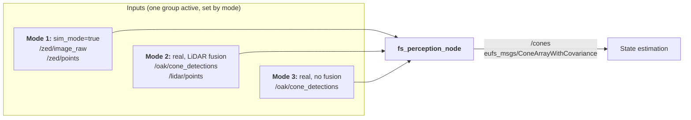
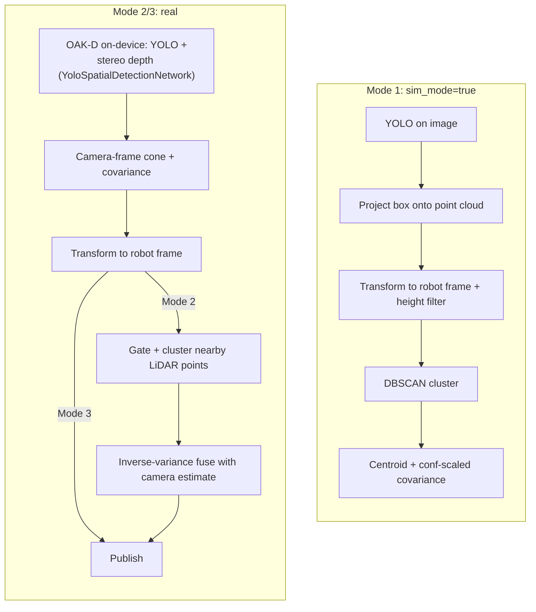

---

sidebar_position: 1
description: Purpose, architecture, interfaces, etc.

---

# Overview

## Purpose

The purpose of the perception module is to convert raw sensor data into usable information for upstream modules. More
specifically, we do this by taking in camera and LiDAR data and outputting an array containing the locations, color
classifications, and covariances (estimate uncertainty) of the cones on the track. This array is passed to the state 
estimation module.

## Architecture

Currently, the perception module consists of a singular ROS node called `fs_perception_node`. This node operates in one
of three modes:
1. `sim_mode=true`
2. `sim_mode=false, use_lidar_fusion=false`
3. `sim_mode=false, use_lidar_fusion=true`

Regardless of the mode, `fs_perception_node` always publishes `eufs_msgs/ConeArrayWithCovariance` messages to the
`/cones` topic. What does depend on the mode, however, is the topic(s) `fs_perception_node` subscribes to. Intuitively,
this makes sense; we have different data sources depending on whether we are in sim and/or combining data from both
sensors in real. 



Below is a reference table summarizing the modes and the respective subscribers and publishers:

| **Mode** | `sim_mode` | `use_lidar_fusion` | Subscribes to                              | Publishes to |
|----------|------------|--------------------|--------------------------------------------|--------------|
| 1        | `true`     | -                  | `/zed/image_raw`<br/>`/zed/points`         | `/cones`     |
| 2        | `false`    | `true`             | `/oak/cone_detections`<br/>`/lidar/points` | `/cones`     |
| 3        | `false`    | `false`            | `/oak/cone_detections`                     | `/cones`     |

## Interfaces

### Inputs

Below we break down each of the input/output topics by their type and their msg definitions. This information is available 
online, but we aim to provide an accessible reference here. The `msg` definitions are pulled from their authoritative
sources:
- `/zed/image_raw`
  - `msg_type`: `sensor_msgs.Image`
```
# This message contains an uncompressed image
# (0, 0) is at top-left corner of image

std_msgs/Header header # Header timestamp should be acquisition time of image
                             # Header frame_id should be optical frame of camera
                             # origin of frame should be optical center of cameara
                             # +x should point to the right in the image
                             # +y should point down in the image
                             # +z should point into to plane of the image
                             # If the frame_id here and the frame_id of the CameraInfo
                             # message associated with the image conflict
                             # the behavior is undefined

uint32 height                # image height, that is, number of rows
uint32 width                 # image width, that is, number of columns

# The legal values for encoding are in file src/image_encodings.cpp
# If you want to standardize a new string format, join
# ros-users@lists.ros.org and send an email proposing a new encoding.

string encoding       # Encoding of pixels -- channel meaning, ordering, size
                      # taken from the list of strings in include/sensor_msgs/image_encodings.hpp

uint8 is_bigendian    # is this data bigendian?
uint32 step           # Full row length in bytes
uint8[] data          # actual matrix data, size is (step * rows)
```
- `/zed/points`
  - `msg_type`: `sensor_msgs.PointCloud2`
```
# This message holds a collection of N-dimensional points, which may
# contain additional information such as normals, intensity, etc. The
# point data is stored as a binary blob, its layout described by the
# contents of the "fields" array.
#
# The point cloud data may be organized 2d (image-like) or 1d (unordered).
# Point clouds organized as 2d images may be produced by camera depth sensors
# such as stereo or time-of-flight.

# Time of sensor data acquisition, and the coordinate frame ID (for 3d points).
std_msgs/Header header

# 2D structure of the point cloud. If the cloud is unordered, height is
# 1 and width is the length of the point cloud.
uint32 height
uint32 width

# Describes the channels and their layout in the binary data blob.
PointField[] fields

bool    is_bigendian # Is this data bigendian?
uint32  point_step   # Length of a point in bytes
uint32  row_step     # Length of a row in bytes
uint8[] data         # Actual point data, size is (row_step*height)

bool is_dense        # True if there are no invalid points
```
- `/oak/cone_detections`
  - `msg_type`: `eufs_msgs.msg/ConeArrayWithCovariance`
  - Polling Rate: 30Hz, set in `sensors/config/oak_camera.yaml`
```
#Array of 2D cone locations (z = 0) with covariances

std_msgs/Header header

ConeWithCovariance[] blue_cones
ConeWithCovariance[] yellow_cones
ConeWithCovariance[] orange_cones
ConeWithCovariance[] big_orange_cones
ConeWithCovariance[] unknown_color_cones
```
- `/lidar/points`
  - `msg_type`: `sensor_msgs.PointCloud2`
```
# This message holds a collection of N-dimensional points, which may
# contain additional information such as normals, intensity, etc. The
# point data is stored as a binary blob, its layout described by the
# contents of the "fields" array.
#
# The point cloud data may be organized 2d (image-like) or 1d (unordered).
# Point clouds organized as 2d images may be produced by camera depth sensors
# such as stereo or time-of-flight.

# Time of sensor data acquisition, and the coordinate frame ID (for 3d points).
std_msgs/Header header

# 2D structure of the point cloud. If the cloud is unordered, height is
# 1 and width is the length of the point cloud.
uint32 height
uint32 width

# Describes the channels and their layout in the binary data blob.
PointField[] fields

bool    is_bigendian # Is this data bigendian?
uint32  point_step   # Length of a point in bytes
uint32  row_step     # Length of a row in bytes
uint8[] data         # Actual point data, size is (row_step*height)

bool is_dense        # True if there are no invalid points
```

### Outputs
- `cones/`
  - `msg_type`: `eufs_msgs.msg/ConeArrayWithCovariance`
```
#Array of 2D cone locations (z = 0) with covariances

std_msgs/Header header

ConeWithCovariance[] blue_cones
ConeWithCovariance[] yellow_cones
ConeWithCovariance[] orange_cones
ConeWithCovariance[] big_orange_cones
ConeWithCovariance[] unknown_color_cones
```

### Parameters

#### `sim_mode`

Boolean parameter used by `fs_perception_node`. Dictates flow of initialization.

#### `use_lidar_fusion`

Boolean parameter used by `fs_perception_node`. Dictates callback logic in `_init_real_mode()`.

## Implementation

### Pipeline

`fs_perception_node`'s internal pipeline differs by mode.

**Mode 1 (`sim_mode=true`):** YOLO and clustering both run in this node, on the host.
1. `/zed/image_raw` is resized by `image_scale_factor` and run through a YOLO model (`weights_path`) to get 2D bounding 
boxes per cone.
2. Each box is projected onto `/zed/points`, isolating the points inside its (scaled) ROI.
3. ROI points are transformed into robot frame and filtered to a plausible cone-height band.
4. DBSCAN (`dbscan_eps`, `dbscan_min_samples`) clusters the filtered points; the largest cluster's centroid is the cone 
position. Detections with no surviving cluster are dropped.
5. Covariance is `BASE_ERROR / max(confidence, 0.01)` — confidence-scaled, not geometry-aware.

**Mode 2 & 3 (`sim_mode=false`):** YOLO and stereo-depth fusion both happen on the OAK-D's onboard Myriad X VPU via 
depthai's `YoloSpatialDetectionNetwork` — the Jetson never runs inference. `oak_camera_node` (in the `sensors` 
container) just polls the device's detection queue and republishes camera-frame cone positions with the same 
`BASE_ERROR`-scaled covariance. `fs_perception_node`'s job in real mode is lighter:
- **Mode 3 (no fusion):** apply the camera→robot-frame transform to each OAK detection and republish. No clustering, no 
YOLO — minimal Jetson compute.
- **Mode 2 (fusion):** same transform, plus: parse and transform `/lidar/points` into robot frame, gate LiDAR points 
within `lidar_gate_radius` of each camera detection, cluster the gated points with the same DBSCAN logic as Mode 1, and combine the LiDAR centroid with the camera estimate via inverse-variance weighting (see below). If no LiDAR points survive gating (occlusion, out of FOV, etc.), the node falls back to the camera-only estimate rather than dropping the detection.



### Calibration and Transforms

#### Camera -> robot frame

The OAK-D’s optical frame (`x` right, `y` down, `z` forward) is converted to `base_footprint` 
(`x` forward, `y` left, `z` up) with a fixed mount offset (`camera_x/y/z_offset`):

```
robot_x = z_cam + cam_x
robot_y = -x_cam + cam_y
robot_z = -y_cam + cam_z   # dropped to 0 downstream of perception (flat-ground assumption)
```

Camera-derived covariance is additionally inflated with a range term before fusion, since stereo depth noise grows with 
distance but the OAK node’s own covariance is only confidence-scaled: 
`covariance *= 1 + camera_range_variance_coeff * z_cam^2`.

#### LiDAR -> camera frame
LiDAR and camera are rigidly mounted but not co-located, so LiDAR points need their own extrinsic 
calibration before fusion. This is a one-time, per-car calibration (`calibrate_lidar_camera.py`), not something 
recomputed at runtime:
1. Place 5+ cones spread in both angle and distance within the overlapping FOV of both sensors. 
2. Measure the vertical offset between LiDAR and camera mounting points by hand (the one quantity a flat-ground point 
set structurally can’t solve for) and pass it as `--z-offset`. 
3. The script matches camera detections to LiDAR cluster centroids by sorting both by bearing angle, then solves a 2D 
rigid transform (yaw `theta`, translation `tx`, `ty`) via closed-form 2D Procrustes/Kabsch (SVD)
4. Output is written to `lidar_camera_calibration.yaml` (`theta_rad`, `tx_m`, `ty_m`, `z_offset_m`, `rms_residual_m`) 
and loaded by `fs_perception_node` at startup via `lidar_calibration_path`. RMS residual over 15cm triggers a warning 
to re-check correspondence before trusting the result.

#### Sensor fusion

Where both a camera and LiDAR estimate exist for the same cone, `fs_perception_node` combines them by inverse-variance 
weighting rather than a flat average or a hard LiDAR-overrides-camera rule:

```
w_a, w_b = 1/var_a, 1/var_b
fused_val = (val_a * w_a + val_b * w_b) / (w_a + w_b)
fused_var = 1 / (w_a + w_b)
```

### Models

Cone detection used YOLOv8, trained on [FSOCO](https://www.fsoco-dataset.com/) imagery, with four classes matching 
`CLASS_MAP`: `blue`, `yellow`, `orange`, `big_orange`. Training (`yolo/train.py`) runs at 640px input with
augmentation tuned for the track environment. The same trained model is deployed in two different runtimes depending
on mode:
- **Sim:** the raw Ultralytics `.pt` checkpoint, run via `ultralytics.YOLO` on the GPU/CPU (`weights_path`)
- **Real:** exported and converted to a `.blob` (plus a companion `.json` describing anchors, class count, and I/O
shapes) for on-device inference on the OAK-D's via depthai's `YoloSpatialDetectionNetwork`. The `.json` is required
to decode YOLO's raw output on-device and must match the exact anchor/class config the model was exported with

Detection confidence scales output covariance directly in both runtimes. A lower-confidence detection is reported
with proportionally larger uncertainty rather than being thresholded away outright.
